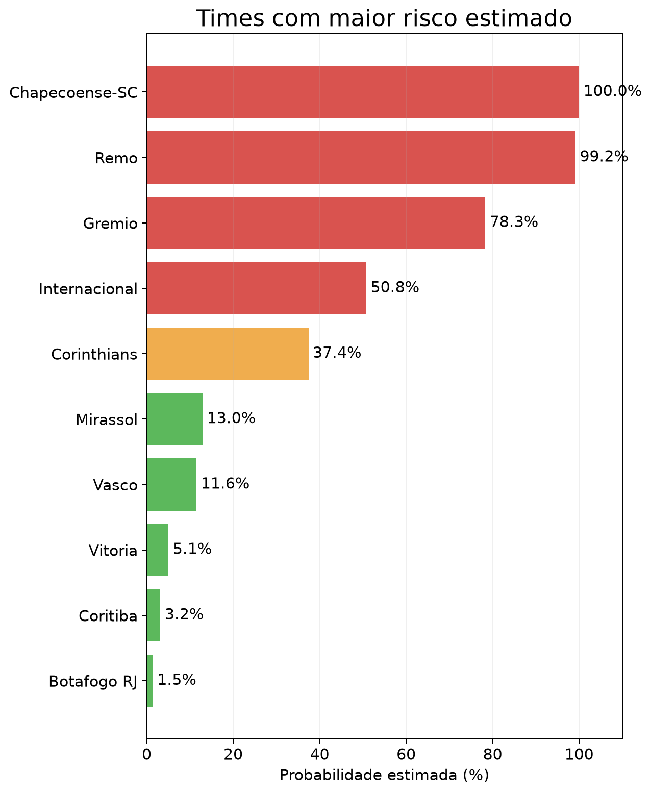
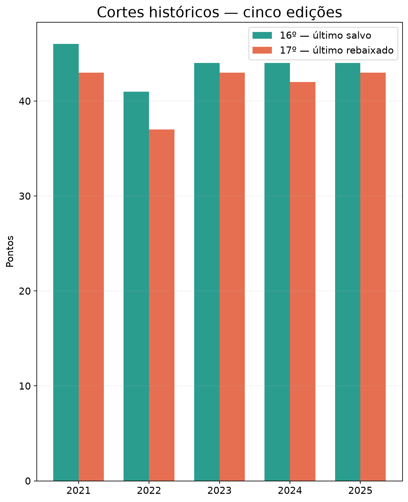
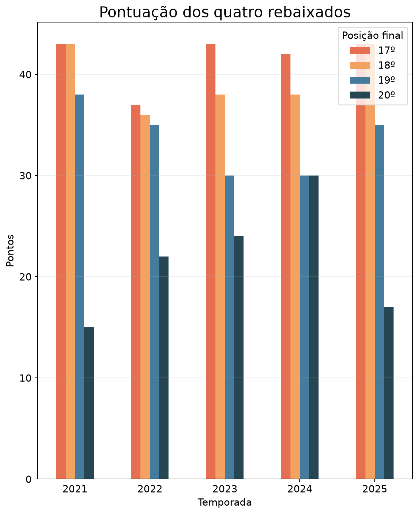
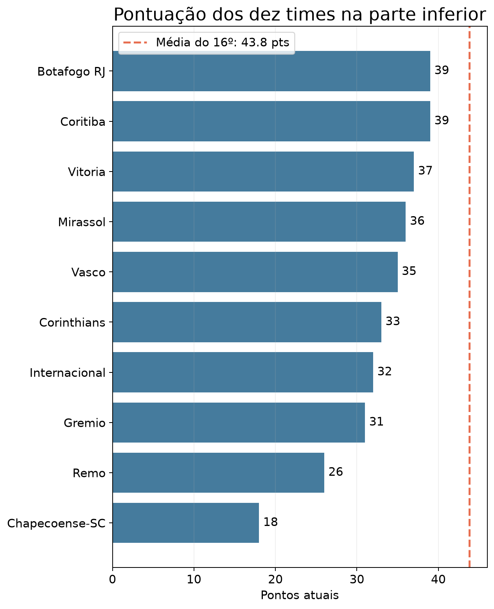

# Dashboard analítico de risco de rebaixamento

Projeto de portfólio que responde: **dada a classificação de hoje e os jogos pendentes, qual é a chance estimada de cada time terminar entre os últimos colocados?** É um exemplo didático e reproduzível, não uma previsão garantida.

## Arquitetura e fluxo de dados

```text
football-data.co.uk (CSV público)
          │
          ▼
 src/ingest.py ──► DuckDB: raw_matches + etl_runs
                         │
                         ▼
               dbt: staging → intermediate → marts
                         │                       │
                         │             standings + jogos pendentes
                         ▼                       ▼
                   src/simulate.py ──► raw_relegation_estimates (snapshots)
                                             │
                                             ▼
                                   dbt marts
                         ┌────────────┴─────────────┐
                         ▼                          ▼
                  FastAPI + Redis/RQ         JupyterLab + Plotly
                                             (DuckDB + notebook)
```

**Componentes e ferramentas:** Python 3.11–3.14, DuckDB como warehouse local, dbt-duckdb, FastAPI, Redis/RQ para atualizações assíncronas e JupyterLab/Plotly como única interface de análise e visualização. O comando integrado é `python -m src.run_pipeline`; as camadas também podem ser executadas separadamente (instruções abaixo).

## 1. Ingestão (ETL)

O projeto está configurado para o **Campeonato Brasileiro Série A de 2026** (`SEASON=2026`, `LEAGUE=BRA`). `src/ingest.py` prioriza o arquivo `BRA.csv` na raiz do projeto (o arquivo fornecido para esta execução); se ele não existir, baixa `https://www.football-data.co.uk/new/BRA.csv`. Esse CSV público reúne temporadas do Brasileirão e o pipeline filtra `Season=2026` e `League=Serie A`. A fonte dispensa chave de API. Para outras ligas europeias no mesmo provedor, o padrão é diferente (`/mmz4281/{temporada}/{divisão}.csv`); esse caminho não é usado para o Brasileirão.

- Trata falhas HTTP/rede com timeout e até três tentativas com espera exponencial; valida as colunas esperadas e descarta linhas sem data ou times.
- Classifica partida sem placar como agendada. Placar incompleto é tratado como ausente. Para o Brasileirão, considera apenas temporada 2026 e Série A.
- Reprocessamento idempotente: substitui atomicamente apenas a partição temporada/liga em `raw_matches`; novas execuções são mantidas em `etl_runs` com status, contagem e mensagem de erro. Uma cópia UTF-8 do CSV fica em `data/raw/` (não versionada) e é reutilizada como cache se a fonte estiver indisponível. Para carga offline inicial, salve o CSV baixado manualmente como `data/raw/2026_BRA.csv`.
- Execute uma liga/temporada por processo. O padrão pode ser configurado com `.env` (copie `.env.example` para `.env`); variáveis de ambiente sobrescrevem o arquivo.

**Limitações e uso da fonte:** a disponibilidade dos CSVs da temporada corrente não é garantida nem tem SLA; arquivos podem ainda não existir, ter atrasos, correções ou colunas diferentes. O projeto valida o esquema e falha claramente, mas não preenche resultados faltantes. Códigos de clubes/competições e cobertura variam por ano. Confira os termos atuais de uso/redistribuição e atribua a fonte; não presuma autorização para uso comercial ou para republicar os arquivos. Não há estatísticas de jogadores ou dados ao vivo.

## 2. Modelagem analítica (dbt + DuckDB)

Projeto em `dbt/`; `dbt/profiles.yml` aponta para `warehouse/football.duckdb` por padrão (sobrescreva com `DB_PATH`).

- **Staging:** `stg_matches` tipa/normaliza os jogos atuais; `stg_brazil_historical_matches` prepara as edições anteriores; `stg_relegation_estimates` normaliza snapshots.
- **Intermediate:** `int_team_match_results` converte cada resultado atual em uma linha por time; `int_team_standings` agrega pontos, vitórias, gols e saldo; `int_remaining_fixtures` seleciona ou infere os confrontos restantes; `int_brazil_historical_standings` reconstitui as tabelas finais de 2021–2025.
- **Marts:** `mart_current_standings` classifica por pontos, vitórias, saldo e gols marcados; `mart_remaining_fixtures` expande cada partida para a perspectiva dos times; `mart_relegation_estimates` mantém snapshots de probabilidade; `mart_historical_relegation_thresholds` calcula os pontos do 16º (último salvo) e 17º (último rebaixado); `mart_historical_relegated_teams` detalha os quatro rebaixados em cada edição.
- Testes dbt incluem `not_null`, `unique`, `accepted_values`, relacionamentos e testes SQL customizados para consistência da tabela, faixa de probabilidades, completude do calendário e integridade das cinco temporadas históricas.
- Descrições de fontes e modelos estão em YAML; gere a documentação dbt com os comandos abaixo.

### Método e premissas da estimativa

`src/simulate.py` executa Monte Carlo (20 mil simulações por padrão) dos jogos ainda sem placar. Para cada time, estima gols esperados em casa/fora usando taxas de gols marcados e sofridos, com shrinkage de cinco jogos para a média da liga. Placares são sorteados de Poisson independentes; os pontos, vitórias, saldo e gols existentes são mantidos e os jogos simulados acrescentam seus valores. O risco é a fração de simulações em que o time termina entre os quatro últimos. O desempate usa pontos, vitórias, saldo, gols marcados e nome do time.

O CSV recebido contém resultados concluídos, não datas dos jogos restantes. Para completar o calendário do Brasileirão, `int_remaining_fixtures` usa o formato de turno e returno: todos os pares direcionados entre os 20 times (380 partidas) menos os confrontos já concluídos. Assim são inferidos os adversários e o mando de campo restantes, mas **não datas**; `match_date` fica nulo para esses jogos. O teste `brazil_schedule_completeness` valida 20 times e 380 partidas entre concluídas e restantes. A simulação não utiliza a data, apenas o confronto e o mando.

As taxas têm pouca informação no começo da temporada; o prior reduz extremos, mas não elimina incerteza. O modelo não considera força do elenco, lesões, transferências, mudanças de técnico, calendário congestionado ou dependência entre resultados. As partidas são tratadas como independentes e as médias não evoluem durante a simulação. Portanto, a probabilidade é uma **estimativa condicionada aos dados e premissas**, sujeita à qualidade e atualização da fonte. Semente, número de simulações, número de vagas e horário ficam registrados em cada snapshot. Para repetir uma execução, configure `RANDOM_SEED`.

Para contextualizar os pontos atuais, o pipeline calcula as classificações completas de **2021 a 2025**: pontos do 16º colocado (último salvo), do 17º (último rebaixado) e dos quatro clubes rebaixados. O notebook mostra as linhas de corte por temporada, a média histórica do 16º como meta indicativa e compara a pontuação atual com essa referência. É uma comparação histórica — não uma garantia da pontuação necessária em 2026.

## 3. API, fila e observabilidade

API REST em `src/api/main.py`, com documentação Swagger em `/docs`:

| Rota | Descrição |
| --- | --- |
| `GET /api/v1/leagues/{league}/teams?season=2026&limit=100&offset=0` | Classificação atual, paginada (`league=BRA`) |
| `GET /api/v1/leagues/{league}/probabilities?season=2026&limit=100&offset=0` | Snapshot mais recente, ordenado pelo risco (`league=BRA`) |
| `GET /api/v1/leagues/{league}/teams/{team}/history?season=2026&limit=100&offset=0` | Histórico paginado de estimativas do time (`league=BRA`) |
| `GET /api/v1/leagues/{league}/historical-thresholds?limit=5` | Cortes de pontos do 16º e 17º lugares nas cinco edições |
| `GET /api/v1/leagues/{league}/historical-relegated-teams?limit=100` | Os quatro rebaixados, posições e pontos por edição |
| `POST /api/v1/updates` | Enfileira a execução completa do pipeline (HTTP 202) |
| `GET /healthz` | Verifica acesso ao warehouse |
| `GET /metrics` | Métricas Prometheus de requisições e latência |

Temporada, limite e offset são validados; respostas têm estrutura `items/limit/offset/count`. Logs são JSON com timestamp, nível e logger. A fila `updates` usa Redis/RQ; o worker executa ingestão, dbt, simulação e testes fora do processo HTTP. A API assume que o warehouse foi inicializado e está disponível; API/worker não substituem a execução inicial da camada de dados. Não há autenticação/rate limit: é uma configuração para demonstração local, não exposição pública.

## 4. Notebook de exploração e apresentação

`notebooks/bra_2026_analise.ipynb` é a única interface de visualização. Documenta a limpeza do CSV, refaz a tabela para conferi-la com dbt e inclui gráficos Plotly interativos de risco, pontos atuais, cortes históricos, quatro rebaixados e evolução dos snapshots. O notebook consome `BRA.csv` e o DuckDB criado pelo pipeline, sem depender da API para renderizar. A última seção exporta um PDF de cinco páginas e PNGs em `reports/linkedin/` para carrossel no LinkedIn; a plataforma não executa gráficos interativos embutidos em notebooks.

### Gráficos

O GitHub não renderiza os gráficos Plotly interativos do notebook. Estas versões estáticas podem ser visualizadas diretamente nesta página:

| Maiores riscos estimados | Cortes históricos |
| --- | --- |
|  |  |

| Pontos dos rebaixados | Pontos atuais vs. referência |
| --- | --- |
|  |  |

[Ver a capa do carrossel](reports/linkedin/01_capa.png) · [Baixar o carrossel completo em PDF](reports/linkedin/brasileirao_2026_carrossel.pdf)

## Executar localmente

Use Python 3.11–3.14 (Python 3.14 foi usado nesta execução; wheels de algumas dependências ainda podem não estar disponíveis no Python 3.15). Redis é necessário para o endpoint de atualização/worker; ingestão, dbt, API de leitura e notebook podem funcionar sem Redis.

```bash
python -m venv .venv
# Linux/macOS: source .venv/bin/activate
# Windows PowerShell: .venv\Scripts\Activate.ps1
pip install -r requirements.txt
cp .env.example .env   # PowerShell: Copy-Item .env.example .env
```

Edite `SEASON` e `LEAGUE` em `.env` se necessário. Execute a integração completa:

```bash
python -m src.run_pipeline
```

Ou execute as camadas separadamente, nesta ordem:

```bash
# 1. Ingestão (usa SEASON/LEAGUE do ambiente ou .env)
python -m src.ingest

# 2. Tabela e calendário necessários à simulação
dbt run --project-dir dbt --profiles-dir dbt --select +mart_current_standings +int_remaining_fixtures

# 2b. Simulação; grava um novo snapshot auditável
python -m src.simulate

# 2c. Atualizar todos os marts e rodar os testes de qualidade
dbt run --project-dir dbt --profiles-dir dbt
dbt test --project-dir dbt --profiles-dir dbt

# Documentação dbt
dbt docs generate --project-dir dbt --profiles-dir dbt
dbt docs serve --project-dir dbt --profiles-dir dbt

# 3. API de leitura
uvicorn src.api.main:app --reload

# 3b. Em outro terminal, para habilitar POST /api/v1/updates
docker compose up -d redis
python -m src.worker

# 4. Abra o notebook de análise
py -3.14 -m jupyter lab notebooks/bra_2026_analise.ipynb
```

Os comandos Python leem `.env` automaticamente. O CLI dbt lê variáveis do ambiente do shell, não o arquivo `.env`; para um `DB_PATH` customizado, defina essa variável no shell antes dos comandos dbt (ou use `python -m src.run_pipeline`, que encaminha o caminho correto automaticamente). Sem customização, o caminho padrão é o mesmo.

No PowerShell, `cp` pode ser substituído por `Copy-Item`. O JupyterLab abre no navegador local; a API REST continua disponível para consumo independente em `http://localhost:8000` e Swagger em `/docs`.

### Compartilhar em uma apresentação na mesma rede local

Se outras pessoas estiverem conectadas à mesma rede Wi-Fi/LAN, inicie o JupyterLab escutando na interface de rede. Substitua `192.168.15.2` pelo IPv4 mostrado por `ipconfig` no computador que está servindo o projeto:

```powershell
py -3.14 -m jupyter lab notebooks/bra_2026_analise.ipynb --no-browser --ip=0.0.0.0 --port=8888
```

O Jupyter imprime uma URL com token de acesso; compartilhe essa URL apenas com participantes de confiança na rede local. Jupyter permite executar código no computador que o hospeda. Não desative o token, não encaminhe a porta no roteador e não publique o endereço na internet.

Se o Firewall do Windows bloquear o acesso, abra PowerShell **como Administrador** e permita a porta 8888 apenas para a sub-rede local confiável (ajuste a sub-rede se necessário):

```powershell
New-NetFirewallRule -DisplayName "Brasileirao 2026 Jupyter LAN" -Direction Inbound -Action Allow -Protocol TCP -LocalPort 8888 -RemoteAddress 192.168.15.0/24 -Profile Public
```

### Agendamento

Para atualização periódica, agende `python -m src.run_pipeline` uma vez por dia (ou após a publicação dos resultados), via cron, Agendador de Tarefas do Windows ou um scheduler de CI. O CSV é um snapshot, portanto rodar várias vezes ao dia normalmente não melhora a informação. A rota `POST /api/v1/updates` dispara o mesmo fluxo sob demanda. Em produção, use lock/concorrência controlada para impedir duas cargas simultâneas e adicione alertas de falha.

### Comandos isolados por camada

| Camada | Comando principal | Dependências externas |
| --- | --- | --- |
| Ingestão | `python -m src.ingest` | Internet e CSV disponível |
| Modelagem + estimativa | comandos dbt e `python -m src.simulate` acima | Ingestão feita; DuckDB local |
| API | `uvicorn src.api.main:app --reload` | Warehouse preparado |
| Worker/atualização enfileirada | `python -m src.worker` | Redis (`docker compose up -d redis`) |
| Análise e visualização | `py -3.14 -m jupyter lab notebooks/bra_2026_analise.ipynb` | Pipeline executado; JupyterLab e Plotly instalados |
